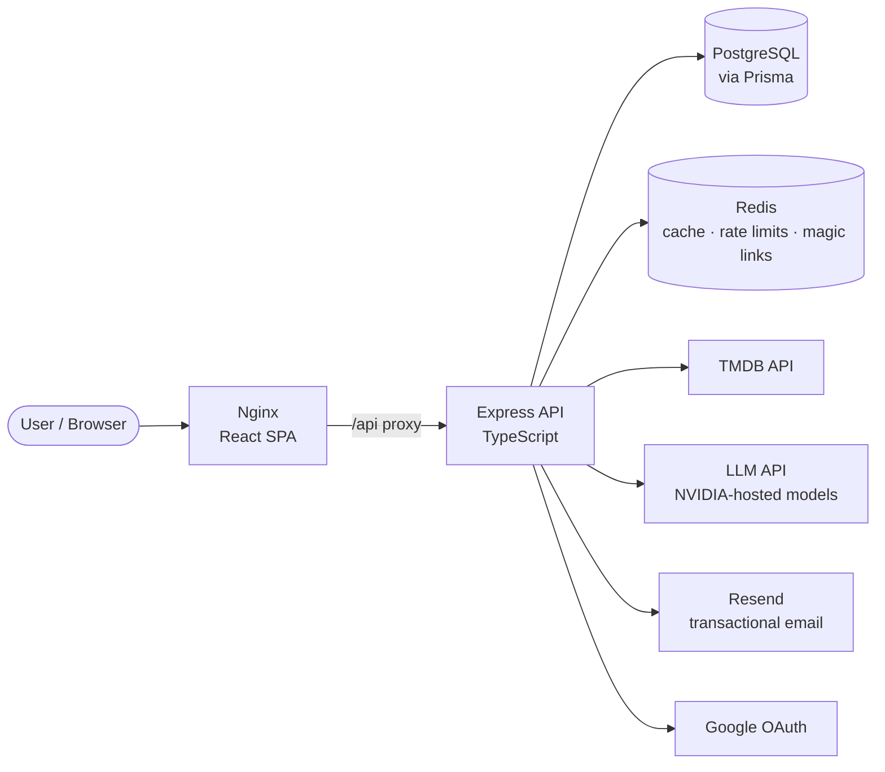

<div align="center">


# 🎬 MovieBox

### AI-powered movie discovery platform: search, track, review, and chat your way to the next movie night.

<p>
  
  
  
  
  
  
  
  
</p>

[Features](#-features) · [Screenshots](#-screenshots) · [Architecture](#-architecture) · [Engineering Highlights](#-engineering-highlights) · [Quick Start](#-quick-start) · [API](#-api-overview)

</div>

---

## 📖 About

**MovieBox** is a production-oriented, full-stack movie discovery app. It pulls live data from **TMDB**, adds a personal layer on top (watchlist, favorites, ratings, reviews), and uses **LLM-powered AI** for natural-language search, personalised recommendations, and a built-in chatbot named **Momo**.

It is built to show real-world engineering beyond CRUD: passwordless authentication, Redis-backed caching and rate limiting, CSRF protection, a typed API layer, database migrations, automated tests, and a fully containerised deployment.

> **TL;DR for recruiters:** React + TypeScript frontend, Express + Prisma + PostgreSQL backend, Redis for caching/rate limiting/auth tokens, AI integration with model fallback, Docker Compose deployment, 14 backend test files.

---

## 📸 Screenshots

<table>
  <tr>
    <td align="center" width="50%">
      <br/>
      <sub><b>Home</b>: trending, popular, upcoming, genre tiles</sub>
    </td>
    <td align="center" width="50%">
      <br/>
      <sub><b>Discover</b>: genre, language, year, rating filters</sub>
    </td>
  </tr>
  <tr>
    <td align="center">
      <br/>
      <sub><b>Movie details</b>: cast, trailer, where to watch, reviews</sub>
    </td>
    <td align="center">
      <br/>
      <sub><b>Momo</b>: the AI movie assistant</sub>
    </td>
  </tr>
  <tr>
    <td align="center">
      <br/>
      <sub><b>AI Search</b>: describe a movie in plain English</sub>
    </td>
    <td align="center">
      <br/>
      <sub><b>Sign in</b>: magic link or Google, no passwords</sub>
    </td>
  </tr>
  <tr>
    <td align="center">
      <br/>
      <sub><b>Profile</b>: avatars, library, account controls</sub>
    </td>
    <td align="center">
      <br/>
      <sub><b>Themes</b>: dark and light mode</sub>
    </td>
  </tr>
</table>

---

## ✨ Features

### 🎞️ Discovery
- Trending, popular, latest and upcoming movies from TMDB
- **Regional industries:** Hollywood, Bollywood, Kollywood, Tollywood, Mollywood and K-Drama
- Advanced filters: genre, language (12 supported), release year, category and rating
- **Instant autocomplete** powered by a custom Trie data structure
- Rich detail pages: cast, crew, trailers, similar and recommended titles, and **where to watch**

### 🤖 AI Features
- **AI Search:** describe what you want in natural language
- **Personalised recommendations** generated from your favorites and watchlist
- **Momo**, a floating chatbot available across the app
- Per-movie AI Q&A
- Automatic **fallback across multiple models** if one fails or returns empty

### 👤 Personal Library
- Watchlist and Favorites, synced when you sign in and cleared when you sign out
- 1 to 5 star **ratings** and written **reviews** (plus TMDB audience reviews)
- Profile setup with avatar selection and **self-service account deletion**

### 🔐 Authentication
- **Passwordless:** email magic link or Google OAuth
- `httpOnly` JWT cookie sessions, no tokens in localStorage
- Role field on users with an admin-only middleware

### 🎨 Experience
- Dark and light themes
- Lazy-loaded routes, loading states and a global error boundary
- Responsive, animated UI built with Tailwind CSS and Framer Motion

---

## 🏗️ Architecture



**Request flow:** the browser talks only to Nginx. Nginx serves the SPA and proxies `/api` to Express. The API checks Redis first for cached TMDB data, falls back to TMDB on a miss, and stores personal data (users, library, reviews) in PostgreSQL.

---

## 🧠 Engineering Highlights

| Area | What was built | Why it matters |
|---|---|---|
| **Rate limiting** | Redis **token-bucket** implemented as an atomic **Lua script**, keyed by IP *and* email/token | No race conditions under concurrency; returns `429` with `Retry-After` and `X-RateLimit-*` headers |
| **Magic-link auth** | 256-bit random token, 10 minute TTL, consumed with Redis `GETDEL` | Links are strictly single-use, even with concurrent verify requests |
| **CSRF protection** | `Origin` validation plus `Sec-Fetch-Site` check on every state-changing request | Defends cookie sessions without extra client tokens |
| **Hardening** | Helmet headers, strict CORS, 100 kb body limit, Zod validation, OAuth `state` cookie, startup env validation | Secure by default; the server refuses to boot with a weak `JWT_SECRET` |
| **Caching** | Redis JSON cache with TTLs that **fails open** | If Redis is down, users still get data from TMDB |
| **Search** | In-memory **Trie** for prefix autocomplete | Fast suggestions without hitting TMDB on every keystroke |
| **AI resilience** | Multi-model fallback chain, request timeouts, graceful errors | AI features degrade gracefully instead of breaking pages |
| **Data layer** | Prisma schema with 7 models, cascade deletes, composite unique and performance indexes, 7 migrations | Clean relational design with a documented evolution |
| **DevOps** | Multi-stage Dockerfiles, Compose with health checks and `depends_on` conditions | One command brings up the whole stack in the right order |
| **Testing** | 14 Vitest files covering auth, CSRF, rate limiting (incl. concurrency and Redis), validators, Trie, TMDB service and more | The security-critical paths are tested |

---

## 🧰 Tech Stack

| Layer | Technologies |
|---|---|
| **Frontend** | React 19, TypeScript, Vite, Tailwind CSS v4, React Router 7, Zustand, Framer Motion, Axios, Lucide, Radix UI |
| **Backend** | Node.js, Express 5, TypeScript, Zod, JWT, Helmet, CORS |
| **Database** | PostgreSQL 18, Prisma ORM |
| **Cache and Queues** | Redis 7 (ioredis) |
| **Integrations** | TMDB API, LLM API via OpenAI-compatible SDK (NVIDIA), Resend email, Google OAuth |
| **DevOps** | Docker, Docker Compose, Nginx |
| **Testing** | Vitest |

---

## 🚀 Quick Start

### Prerequisites
- Docker and Docker Compose **or** Node.js 24+, PostgreSQL and Redis
- A free [TMDB API key](https://www.themoviedb.org/settings/api)
- Optional: NVIDIA API key (AI), Resend key (email), Google OAuth credentials

### 1. Clone

```bash
git clone https://github.com/alanbabu518-spec/MovieBox.git
cd MovieBox
```

### 2. Configure the server

```bash
cp server/.env.example server/.env
```

Fill in at minimum `TMDB_API_KEY` and a `JWT_SECRET` of **32+ characters**.
Generate one with:

```bash
openssl rand -hex 32
```

### 3a. Run with Docker (recommended)

```bash
docker compose up --build
```

| Service | URL |
|---|---|
| App | http://localhost:3000 |
| API | http://localhost:5001 |
| PostgreSQL | localhost:5433 |
| Redis | localhost:6380 |

Apply database migrations once the containers are up:

```bash
docker compose exec server npx prisma migrate deploy
```

### 3b. Run locally without Docker

**Backend**
```bash
cd server
npm install
npx prisma generate
npx prisma migrate dev
npm run dev            # http://localhost:5000
```

**Frontend** (in a second terminal)
```bash
cd client
npm install
cp .env.example .env   # set VITE_API_BASE_URL=http://localhost:5000/api
npm run dev            # http://localhost:5173
```

> For local development set `CLIENT_URL=http://localhost:5173` in `server/.env`. CSRF protection only accepts requests from the configured frontend origin.

### 4. Run the tests

```bash
cd server
npm test
```

---

## ⚙️ Environment Variables

| Variable | Required | Description |
|---|:---:|---|
| `PORT` | ✅ | API port |
| `CLIENT_URL` | ✅ | Frontend origin (used for CORS and CSRF) |
| `DATABASE_URL` | ✅ | PostgreSQL connection string |
| `REDIS_URL` | ✅ | Redis connection string |
| `JWT_SECRET` | ✅ | Minimum 32 characters |
| `JWT_EXPIRES_IN` | ✅ | For example `7d` |
| `TMDB_API_KEY` | ✅ | Movie data |
| `TMDB_BASE_URL` | ✅ | `https://api.themoviedb.org/3` |
| `TRENDING_MOVIES_CACHE_TTL` | ✅ | Cache lifetime in seconds |
| `RESEND_API_KEY` | ➖ | Magic-link emails |
| `GOOGLE_CLIENT_ID` / `GOOGLE_CLIENT_SECRET` / `GOOGLE_CALLBACK_URL` | ➖ | Google sign-in |
| `NVIDIA_API_KEY` / `NVIDIA_BASE_URL` / `NVIDIA_MODEL` | ➖ | AI features |

---

## 🔌 API Overview

All routes are prefixed with `/api`. 🔒 = requires authentication.

| Module | Endpoints |
|---|---|
| **Auth** | `POST /auth/email` · `GET /auth/verify` · `GET /auth/google` · `GET /auth/me` 🔒 · `PATCH /auth/profile` 🔒 · `POST /auth/logout` · `DELETE /auth/account` 🔒 |
| **Movies** | `GET /movies/trending` · `/trending/:industry` · `/popular` · `/latest` · `/upcoming` · `/search` · `/autocomplete` · `/discover` · `/:tmdbId` · `/:tmdbId/credits` · `/videos` · `/images` · `/similar` · `/watch/providers` |
| **Reviews and Ratings** | `GET/POST /movies/:tmdbId/reviews` · `GET/POST /movies/:tmdbId/ratings` 🔒 |
| **Library** | `GET/POST/DELETE /watchlist` 🔒 · `GET/POST/DELETE /favorites` 🔒 |
| **AI** | `POST /ai/search` 🔒 · `GET /ai/recommendations` 🔒 · `POST /ai/chat` 🔒 · `POST /ai/:tmdbId/ai` 🔒 |
| **Health** | `GET /health` |

---

## 🗂️ Project Structure

```
MovieBox/
├── client/                     # React + TypeScript SPA
│   └── src/
│       ├── pages/              # Route-level pages (lazy loaded)
│       ├── shared/
│       │   ├── components/     # ai · auth · home · layout · movie · moviedetails · ui
│       │   ├── services/       # Typed API clients
│       │   └── context/        # Auth context
│       └── store/              # Zustand stores (library, theme)
├── server/                     # Express + TypeScript API
│   ├── prisma/                 # Schema and migrations
│   └── src/
│       ├── modules/            # auth · movies · ai · reviews · ratings · favorite · watchlist · recommendations
│       ├── middleware/         # auth · csrf · rate limiting · errors
│       ├── integrations/tmdb/  # TMDB client and industry mapping
│       ├── config/             # env · redis · database · cache
│       └── tests/              # Vitest suites
└── docker-compose.yml          # Client + API + PostgreSQL + Redis
```

---

## 🛣️ Roadmap

- [ ] CI/CD pipeline with automated test and build checks
- [ ] Frontend test coverage
- [ ] Social features: follow users and share lists
- [ ] Streaming-availability alerts for watchlist titles

---

## 👨‍💻 Author

**Alan**: BCA student (graduating 2026) specializing in AI, Cloud Computing and DevOps, building full-stack products on the MERN ecosystem and beyond.

[](https://github.com/alanbabu518-spec)
[](https://linkedin.com/in/alanbabu518)

---

## 🙏 Acknowledgements

This product uses the [TMDB API](https://www.themoviedb.org/) but is not endorsed or certified by TMDB.

<div align="center">

⭐ **If you like this project, consider giving it a star!** ⭐

</div>
